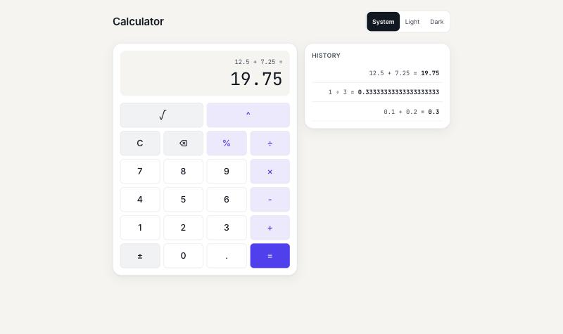

# Sezzle Calculator

A calculator with a Go REST API and a React TypeScript frontend. The browser never does the math. Every result comes from the API, which uses exact decimal arithmetic.



The mobile layout in dark mode is in [docs/screenshots/mobile-dark.jpg](docs/screenshots/mobile-dark.jpg). The error state is in [docs/screenshots/mobile-error.jpg](docs/screenshots/mobile-error.jpg).

## Quick start

You need Docker running.

```bash
docker compose up --build
```

Open http://localhost:8080. Stop with `Ctrl+C`, then `docker compose down`.

`make docker-up` does the same in the background and waits for both health checks. Only one port is exposed. nginx serves the static frontend and forwards `/api` to the backend.

## Run the backend and frontend separately

| Tool | Version |
| --- | --- |
| Go | 1.26 (`backend/go.mod`, toolchain go1.26.11) |
| Node | 24 or newer (`frontend/.nvmrc` pins 24, which the Docker build and CI use) |
| npm | the one bundled with Node |

Vite 8 needs a recent Node. `package.json` sets `engines` to `>=24 <27`.

Backend, on port 8080:

```bash
make -C backend run
```

Frontend, on port 5173. The dev server proxies `/api` to port 8080:

```bash
cd frontend
npm ci
npm run dev
```

Open http://localhost:5173. Run `make help` for every target.

## API

Operands go in as strings and results come back as strings. The full contract is in [docs/API.md](docs/API.md). Every error code is in [docs/ERROR_CODES.md](docs/ERROR_CODES.md). The responses below are real output from a running server, saved in [docs/API_SMOKE.md](docs/API_SMOKE.md).

| Method | Path | Purpose |
| --- | --- | --- |
| POST | `/api/v1/calculate` | Run one operation |
| GET | `/api/v1/operations` | List the supported operations and the limits |
| GET | `/health/live` | Liveness probe |
| GET | `/health/ready` | Readiness probe |

### List operations

```bash
curl localhost:8080/api/v1/operations
```

```json
{"operations":[{"name":"add","arity":2,"symbol":"+","description":"Adds the two operands."},{"name":"subtract","arity":2,"symbol":"-","description":"Subtracts the second operand from the first."},{"name":"multiply","arity":2,"symbol":"*","description":"Multiplies the two operands."},{"name":"divide","arity":2,"symbol":"/","description":"Divides the first operand by the second."},{"name":"power","arity":2,"symbol":"^","description":"Raises the first operand to the whole-number power given by the second."},{"name":"sqrt","arity":1,"symbol":"√","description":"Returns the square root of the operand."},{"name":"percentage","arity":2,"symbol":"%","description":"Returns the first operand percent of the second."}],"limits":{"maxOperandLength":64,"maxExponent":1000,"decimalPrecision":20}}
```

### One success per operation

Each call is `POST /api/v1/calculate` with `Content-Type: application/json`.

```bash
curl -X POST localhost:8080/api/v1/calculate -H "Content-Type: application/json" \
  -d '{"operation":"add","operands":["0.1","0.2"]}'
```

```json
{"operation":"add","operands":["0.1","0.2"],"result":"0.3"}
```

| Operation | Body | Response (HTTP 200) |
| --- | --- | --- |
| subtract | `{"operation":"subtract","operands":["10","4.75"]}` | `{"operation":"subtract","operands":["10","4.75"],"result":"5.25"}` |
| multiply | `{"operation":"multiply","operands":["-2.5","4"]}` | `{"operation":"multiply","operands":["-2.5","4"],"result":"-10"}` |
| divide | `{"operation":"divide","operands":["1","3"]}` | `{"operation":"divide","operands":["1","3"],"result":"0.33333333333333333333"}` |
| power | `{"operation":"power","operands":["2","-2"]}` | `{"operation":"power","operands":["2","-2"],"result":"0.25"}` |
| sqrt | `{"operation":"sqrt","operands":["2"]}` | `{"operation":"sqrt","operands":["2"],"result":"1.4142135623730950488"}` |
| percentage | `{"operation":"percentage","operands":["15","200"]}` | `{"operation":"percentage","operands":["15","200"],"result":"30"}` |

### Key errors

Division by zero (HTTP 422):

```bash
curl -X POST localhost:8080/api/v1/calculate -H "Content-Type: application/json" \
  -d '{"operation":"divide","operands":["10","0"]}'
```

```json
{"error":{"code":"DIVISION_BY_ZERO","message":"Cannot divide by zero.","requestId":"139e5ba9-8f0e-4707-b316-ed9c0db14ad4"}}
```

A bad operand, with the field and reason (HTTP 422):

```bash
curl -X POST localhost:8080/api/v1/calculate -H "Content-Type: application/json" \
  -d '{"operation":"add","operands":["1e5","2"]}'
```

```json
{"error":{"code":"INVALID_OPERAND","message":"An operand is not a valid number.","requestId":"cce3b486-af9e-4fd9-b0c8-7ca385ab8e90","fields":{"operand_index":0,"reason":"exponent"}}}
```

A missing field (HTTP 422):

```bash
curl -X POST localhost:8080/api/v1/calculate -H "Content-Type: application/json" \
  -d '{"operands":["1","2"]}'
```

```json
{"error":{"code":"VALIDATION_FAILED","message":"The request failed validation.","requestId":"17584436-4624-495a-815e-5c1cb2df9b5d","fields":{"operation":"is required"}}}
```

A wrong media type (HTTP 415):

```bash
curl -X POST localhost:8080/api/v1/calculate -H "Content-Type: text/plain" \
  -d '{"operation":"add","operands":["1","2"]}'
```

```json
{"error":{"code":"UNSUPPORTED_MEDIA_TYPE","message":"The content type is not supported.","requestId":"d4f1a0b4-d681-4e5b-8037-6fe33e2d3658"}}
```

### Every error code

Every error has the same shape: `code`, `message`, `requestId` and an optional `fields` object. The `message` is fixed text per code and never echoes user input. The `requestId` matches the `X-Request-ID` response header.

| Code | HTTP | Cause |
| --- | --- | --- |
| `BAD_REQUEST` | 400 | Empty body, invalid JSON, unknown field, wrong field type, trailing data, or a top-level key that repeats or is not lower case (`fields` has `key` and `reason`) |
| `VALIDATION_FAILED` | 422 | `operation` or `operands` is missing, `operation` is over 32 bytes, or `operands` has more than 16 items |
| `UNSUPPORTED_MEDIA_TYPE` | 415 | `Content-Type` is not `application/json` |
| `PAYLOAD_TOO_LARGE` | 413 | Body over 1 MiB |
| `NOT_FOUND` | 404 | Unknown path. `fields.path` repeats at most 256 bytes of it |
| `METHOD_NOT_ALLOWED` | 405 | Wrong method for the path. `fields.path` repeats at most 256 bytes of it |
| `INTERNAL` | 500 | Unexpected server fault. The cause is logged and never sent. |
| `SERVICE_UNAVAILABLE` | 503 | `/health/ready` before startup ends or after shutdown starts |
| `REQUEST_TIMEOUT` | 503 | A calculation runs past the server's request deadline (5s by default) |
| `UNKNOWN_OPERATION` | 422 | `operation` is not in the operations list |
| `INVALID_OPERAND_COUNT` | 422 | Operand count does not match the operation's arity |
| `OPERAND_TOO_LARGE` | 422 | Operand longer than 64 characters |
| `INVALID_OPERAND` | 422 | Operand is not a plain decimal |
| `DIVISION_BY_ZERO` | 422 | Divide by zero, or zero to a negative power |
| `INVALID_EXPONENT` | 422 | Exponent in `power` is not a whole number |
| `EXPONENT_TOO_LARGE` | 422 | Exponent outside -1000 to 1000 |
| `RESULT_TOO_LARGE` | 422 | A `power` result would have more than 640 digits, for example `10^1000` |
| `NEGATIVE_SQUARE_ROOT` | 422 | `sqrt` of a negative number |

<details>
<summary>Real curl output for the remaining error cases</summary>

All bodies are sent with `Content-Type: application/json` unless noted. The full commands are in [docs/API_SMOKE.md](docs/API_SMOKE.md). `INTERNAL`, `SERVICE_UNAVAILABLE` and `REQUEST_TIMEOUT` have no curl example here because a normal request does not trigger them. Tests cover all three.

`NEGATIVE_SQUARE_ROOT`, body `{"operation":"sqrt","operands":["-4"]}`, HTTP 422:

```json
{"error":{"code":"NEGATIVE_SQUARE_ROOT","message":"Cannot take the square root of a negative number.","requestId":"77f8bdf6-c58a-4ba0-aad1-0e13b2cd2658"}}
```

`INVALID_EXPONENT`, body `{"operation":"power","operands":["2","0.5"]}`, HTTP 422:

```json
{"error":{"code":"INVALID_EXPONENT","message":"The exponent must be a whole number.","requestId":"9db8b836-e6db-4946-943f-02b118c352f9","fields":{"operand_index":1}}}
```

`EXPONENT_TOO_LARGE`, body `{"operation":"power","operands":["2","1001"]}`, HTTP 422:

```json
{"error":{"code":"EXPONENT_TOO_LARGE","message":"The exponent is outside the allowed range.","requestId":"b40da9a3-4a9e-4017-b017-3ad05f57a651","fields":{"limit":1000,"operand_index":1}}}
```

`RESULT_TOO_LARGE`, body `{"operation":"power","operands":["9","1000"]}`, HTTP 422:

```json
{"error":{"code":"RESULT_TOO_LARGE","message":"The result would be too large to calculate.","requestId":"59e22c67-ebac-45c2-aca3-280f742d2b77","fields":{"limit":640}}}
```

`UNKNOWN_OPERATION`, body `{"operation":"modulo","operands":["1","2"]}`, HTTP 422:

```json
{"error":{"code":"UNKNOWN_OPERATION","message":"The requested operation is not supported.","requestId":"cf975be3-331f-4534-adc7-34709c3be8ce","fields":{"operation":"modulo"}}}
```

`INVALID_OPERAND_COUNT`, body `{"operation":"add","operands":["1"]}`, HTTP 422:

```json
{"error":{"code":"INVALID_OPERAND_COUNT","message":"The operation received the wrong number of operands.","requestId":"b117774b-72de-476b-921e-819aa2b8a6e8","fields":{"actual":1,"expected":2,"operation":"add"}}}
```

`OPERAND_TOO_LARGE`, with a first operand over 64 characters, HTTP 422:

```json
{"error":{"code":"OPERAND_TOO_LARGE","message":"An operand is larger than the allowed limit.","requestId":"f5084070-7c0e-40a4-9185-d3a73b56ae96","fields":{"limit":64,"operand_index":0}}}
```

`BAD_REQUEST`, body `{"operation":` (cut-off JSON), HTTP 400. An empty body, an unknown field (`"extra":true`) and data after the object return the same code and message:

```json
{"error":{"code":"BAD_REQUEST","message":"The request could not be understood.","requestId":"3ce3b06b-9bac-40e1-bd32-8e2b416e716e"}}
```

`BAD_REQUEST` for a key in the wrong case, body `{"operation":"add","operands":["1","2"],"OPERANDS":["9","9"]}`, HTTP 400. A repeated key returns the same code with `"reason":"duplicate"`. Only exact lowercase `operation` and `operands` are accepted, so two readers of one body never see different values:

```json
{"error":{"code":"BAD_REQUEST","message":"The request could not be understood.","requestId":"f2920dad-6fb6-457f-a23c-3f6df63887b4","fields":{"key":"OPERANDS","reason":"wrong_case"}}}
```

`VALIDATION_FAILED` for 17 operands to `add`, HTTP 422. The count is checked before any operand is parsed. Three operands to `add` still return `INVALID_OPERAND_COUNT`:

```json
{"error":{"code":"VALIDATION_FAILED","message":"The request failed validation.","requestId":"7882a092-c476-40f8-8f66-6e03ac726183","fields":{"operands":"too many"}}}
```

`PAYLOAD_TOO_LARGE`, a 1.1 MB body, HTTP 413:

```json
{"error":{"code":"PAYLOAD_TOO_LARGE","message":"The request body is too large.","requestId":"838bf0e4-2942-47a1-a7eb-eaab52de325f","fields":{"limit":1048576}}}
```

`METHOD_NOT_ALLOWED`, `curl -X GET localhost:8080/api/v1/calculate`, HTTP 405:

```json
{"error":{"code":"METHOD_NOT_ALLOWED","message":"The method is not allowed for this resource.","requestId":"98173eaa-117a-4cb4-ab2a-f53c9947081a","fields":{"method":"GET","path":"/api/v1/calculate"}}}
```

`NOT_FOUND`, `curl localhost:8080/api/v1/nope`, HTTP 404:

```json
{"error":{"code":"NOT_FOUND","message":"The requested resource was not found.","requestId":"1c82b3b7-3071-48f1-8ae9-6f18931b9149","fields":{"method":"GET","path":"/api/v1/nope"}}}
```

</details>

## Tests and coverage

```bash
make test                           # backend (race detector) and frontend
make test-coverage                  # both layers, with coverage reports
cd frontend && npm run test:coverage
```

| Layer | Result | HTML report |
| --- | --- | --- |
| Backend (Go) | <!--cov-backend-->98.2%<!--/cov-backend--> total coverage, race detector on, mocks excluded | `backend/coverage.html` |
| Frontend (React) | <!--cov-frontend-->547<!--/cov-frontend--> tests, 100% statements, branches, functions and lines | `frontend/coverage/index.html` |

CI runs both suites on every push and pull request and uploads both reports as build artifacts. A third CI job builds the Docker stack and smoke tests it through nginx. CI also runs `prettier --check`, `govulncheck` and `npm audit --omit=dev --audit-level=high`.

Mocks are generated, not committed. On a fresh clone run `make test` (or `make mock` first), because a bare `go test ./...` fails until they exist. The frontend `make` targets run `npm ci` themselves when `frontend/node_modules` is missing or older than the lockfile.

Quality gates:

- golangci-lint v2.15.0 with 12 linters, including gosec, gocyclo, dupl and goconst.
- ESLint in strict type-checked mode with jsx-a11y.
- axe-core checks on the calculator in every state, plus a token test for WCAG contrast. See [docs/ACCESSIBILITY.md](docs/ACCESSIBILITY.md).
- Git hooks in `.githooks/` block em dashes and AI co-author lines. Enable them with `make hooks`.
- An automated review pipeline runs `make lint` and `make test` before a push.

Known audit note: `npm audit` reports 7 moderate advisories in `minimatch`, inside `typescript-eslint`. This is dev tooling and does not ship. The production bundle has 0. I did not run `npm audit fix --force` because the fix downgrades the linter.

## Design decisions and assumptions

Each decision has a longer entry in [docs/DECISIONS.md](docs/DECISIONS.md). The structure is in [docs/ARCHITECTURE.md](docs/ARCHITECTURE.md).

- Decimal, not float. A float stores 0.1 as a close neighbour, so `0.1 + 0.2` gives `0.30000000000000004`. The backend uses `shopspring/decimal`, so the answer is `0.3`.
- Operands are strings. JavaScript turns a JSON number into a float before the server sees the value, so the digits are already lost. A string arrives untouched. A JSON number in `operands` returns `400`.
- Half-even rounding, 20 places. Divide, square root and negative powers have results with no end, so they round to 20 decimal places. An exact tie goes to the even digit, so `0.125` becomes `0.12`. Add, subtract, multiply and percentage are exact.
- Percentage means x percent of y. `percentage(15, 200)` is `30`. The other common readings, such as "what percent is x of y", are not supported.
- Input limits. An operand has at most 64 characters. A `power` exponent stays within 1000 either way. A `power` result has at most 640 digits, so `10^1000` is refused even though its exponent is allowed. Calculations stop at the 5 second request deadline. The request body is at most 1 MiB. The operand length, exponent, precision and body limits are config values. The result digit limit is derived: 10 times the operand length.
- One endpoint with an `operation` field. Validation, limits and the error shape live in one handler. A new operation needs no new route. The cost: logs and rate limits keyed on the path cannot tell operations apart.
- 400 versus 422. `400` means the server cannot read the request, so the client code is wrong. `422` means the server read the request but the content breaks a rule, so the user types something else.
- No database. A calculation is a pure function of its input, so the server keeps no state. The history in the UI lives in memory and is gone on reload.
- Operation registry. Each operation is one type with a name, arity, symbol and `Apply`. The registry looks operations up by name and lists them at `GET /api/v1/operations`. `GET /api/v1/operations` also reports the configured limits. The keypad is a static key list that renders at once. When the response arrives, keys for operations the server does not report are disabled, and the input length follows `limits.maxOperandLength`. If the request fails, every key stays enabled and the server still validates each calculation. A new operation is one file and one line of wiring.
- The frontend never computes. The keypad builds an expression, and the API returns the answer.

## Scope and deliberate extras

The brief asked for a working calculator, clear code and tests. These items go beyond the brief. Each one is small. I list them so the scope is clear.

- Theme toggle and history drawer. Light and dark mode and a list of past calculations make the app usable for more than one sum. The history stays in memory.
- Contrast and axe tests. A calculator is a keyboard and touch tool. The tests fail the build if a colour pair or a state breaks WCAG contrast or an accessibility rule.
- Docker hardening. Read-only root filesystem, no Linux capabilities, a non-root user and image digests. A container should hold no more rights than the app needs.
- nginx Content-Security-Policy. The page loads no outside scripts, so the policy blocks them all. The cost is a few lines of config.
- CI Docker smoke test. Unit tests do not show nginx forwarding `/api` to the backend. The smoke test checks the full path.
- Review pipeline. Each change got an automated review plus `make lint` and `make test` before every push, so the local check and the CI check match.
- Vulnerability and format checks. `govulncheck`, `npm audit` and Prettier run in CI to catch known flaws and style drift early.

## What I'd do next with more time

- Generate an OpenAPI spec from the code, so the contract in `docs/API.md` stays in step with the handler.
- Add Playwright end-to-end tests across Chromium, Firefox and WebKit.
- Add rate limiting on `/api/v1/calculate`, keyed per client.
- Add authentication if the app becomes multi-user.
- Store history on the server, per user.
- Add metrics and tracing with Prometheus and OpenTelemetry, using the request ID already on every log line.
- Format numbers by locale in the UI.
- Parse full expressions with operator precedence, instead of one operation at a time.

## AI usage

I used AI tools, mainly Claude Code, to write most of the code. I set the rules, gave one prompt per step and reviewed each result before the next. Every prompt is in [docs/PROMPTS.md](docs/PROMPTS.md), in order, with a line on what each produced.

`AGENTS.md` and `CLAUDE.md` are in the repo for the same reason. They hold the working rules I gave the AI tools while building this. They are not part of the app.
