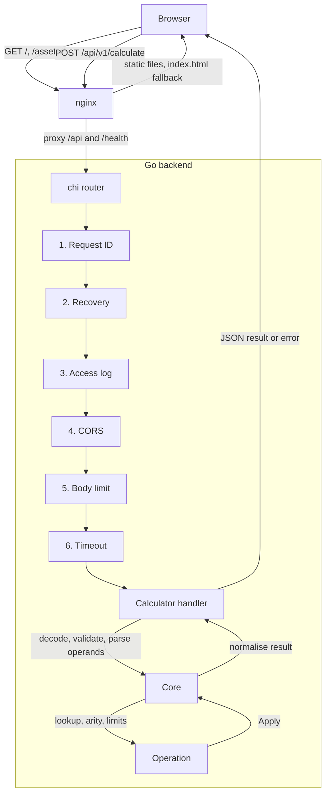
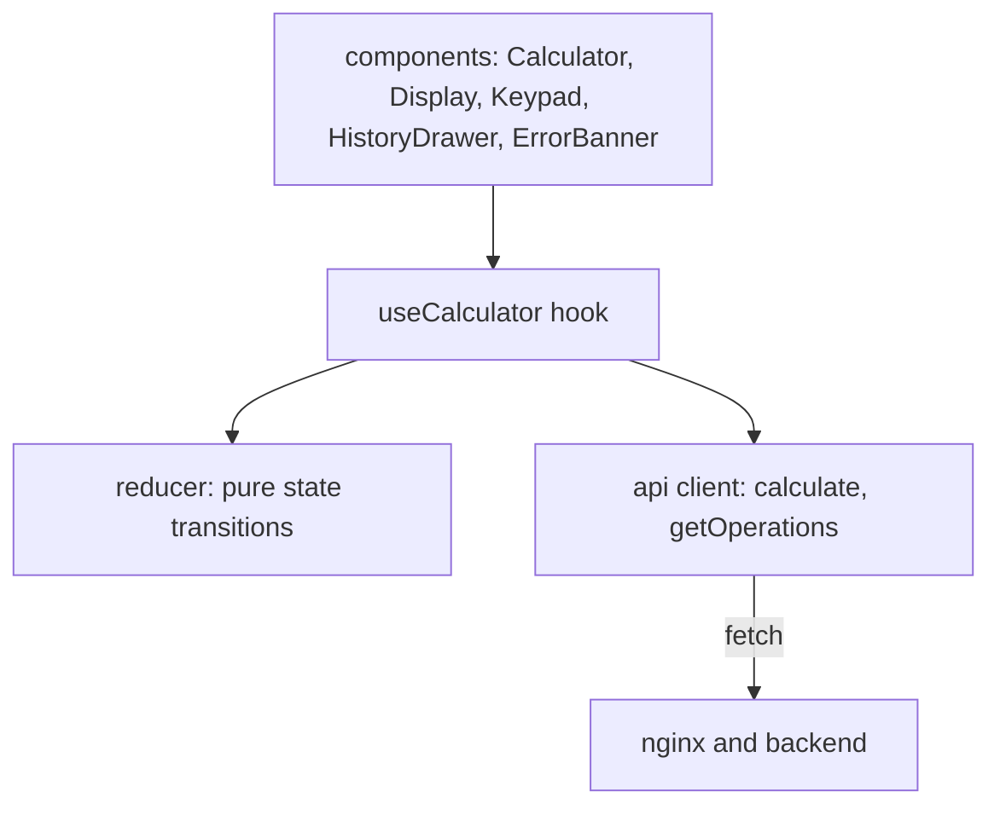

# Architecture

The system is two containers. nginx serves the React bundle and forwards API calls to a Go service. The Go service holds all the arithmetic. There is no database.

## Request flow

Read the diagram from top to bottom. The same path carries the response back to the browser.

## Backend

The router lives in `backend/internal/boot/router.go`. The middleware order matters, so the code comments each position.

| Step | Middleware | Reason for the position |
| --- | --- | --- |
| 1 | Request ID | First, so every later log line and error body carries the ID. |
| 2 | Recovery | Before the access log, so a panic still gets a 500 and a log line. |
| 3 | Access log | Wraps everything below, to time the real work. |
| 4 | CORS | Before the limits, so a rejected preflight costs nothing. |
| 5 | Body limit | Before any handler reads the body. |
| 6 | Timeout | Innermost, so the deadline covers only handler work. |

The calculator module has three layers.

- Handler (`server.go`, `parse.go`, `validate.go`). The handler checks the media type, decodes the JSON, checks the required fields and parses each operand string into a decimal. The handler knows HTTP and nothing about arithmetic.
- Core (`core.go`). The core looks up the operation, checks the operand count, checks the limits, applies the operation and normalises the result. The core knows arithmetic rules and nothing about HTTP.
- Operations (`operations/`). Each operation is one small type with `Name`, `Arity`, `Symbol`, `Description` and `Apply`. The registry maps names to operations and keeps their order.

Other packages:

| Path | Role |
| --- | --- |
| `cmd/api` | The service entry point |
| `cmd/healthcheck` | A tiny probe binary for the Docker healthcheck |
| `internal/boot` | Wiring: config, logger, registry, modules, router, graceful shutdown |
| `internal/config` | Layered TOML config with environment overrides (viper) |
| `internal/constants` | Shared names, so no string appears twice |
| `internal/interceptors` | The six middleware |
| `internal/httpx` | JSON writers, and the 404 and 405 handlers |
| `internal/logger` | Structured logging (zap) |
| `internal/modules/calculator` | The calculator module |
| `internal/modules/health` | Liveness and readiness probes |
| `pkg/apperror` | Error codes, HTTP statuses and the client-safe error body |

Every failure becomes an `apperror` with a code. One function maps the code to the HTTP status and builds the response body, so no handler writes an error by hand.

## Frontend

The frontend has three layers, and each one only talks to the layer below.

- Components in `src/features/calculator/components` draw the state and send actions. They hold no logic.
- `useCalculator` owns the state and the history. The hook runs the request when you press equals.
- The reducer in `state/` is a pure function. The reducer applies typing rules such as one decimal point and a length cap.
- The API client in `src/api` wraps `fetch`, checks response shapes and turns error bodies into typed errors.

The frontend never computes a result. The frontend builds an operation name and operand strings, sends them and shows the reply.

## Deployment

`docker-compose.yml` starts `backend` and `frontend`. The frontend waits until the backend health check passes. Only the frontend publishes a port (8080). The backend image is a static Go binary on distroless, running as a non-root user. The frontend image is Node for the build and unprivileged nginx for serving.

nginx does three jobs. nginx serves hashed assets with a one-year immutable cache, falls back to `index.html` for the single page app and proxies `/api` and `/health` to the backend with `Cache-Control: no-store`.
