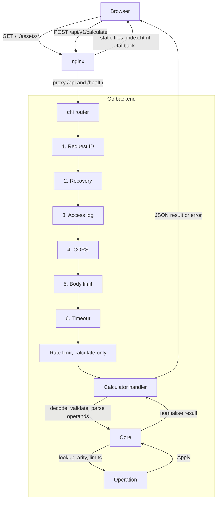
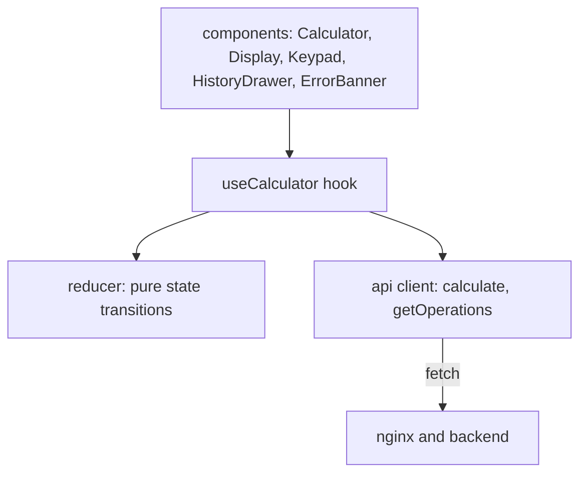

# Design decisions

One entry per decision. Each has the context, the decision and the trade-off.

## 1. Decimal arithmetic, not float

- Context: A calculator must show `0.1 + 0.2` as `0.3`. A 64-bit float stores 0.1 as a close neighbour and returns `0.30000000000000004`.
- Decision: The backend uses `shopspring/decimal` for all math.
- Trade-off: Decimals are slower than floats and need explicit rounding rules. For a calculator the speed does not matter and exact digits do.

## 2. Operands are strings

- Context: JavaScript parses a JSON number into a float before the server sees the value. The digits a user typed are gone on arrival, and a 20-digit integer loses its tail.
- Decision: Operands go in as JSON strings and results come back as strings. A JSON number in `operands` returns `400 BAD_REQUEST`. Top-level keys must be exact lower case and unique, or the request returns `400 BAD_REQUEST` with the key and reason in `fields`. Go's decoder would otherwise match `OPERANDS` to `operands` and keep the last of two duplicates.
- Trade-off: The request is a little less natural to write by hand. Every client must send quotes. In exchange the server sees exactly what the user typed.

## 3. Half-even rounding and a precision of 20

- Context: Divide, square root and negative powers have results with no end, such as `1/3`. Something must cut them off, and the cut must not push totals in one direction.
- Decision: Round to 20 decimal places with half-even rounding. An exact tie goes to the even digit, so `0.125` becomes `0.12`. Add, subtract, multiply and percentage stay exact. The precision is the `decimal_precision` config value.
- Trade-off: Half-even surprises users who learned "round half up". Financial work uses half-even because the errors cancel out over many operations.

## 4. Percentage means x percent of y

- Context: "Percentage" has several meanings. Readings include "x percent of y", "what percent is x of y" and "x increased by y percent".
- Decision: `percentage(x, y)` is `x / 100 * y`. So `percentage(15, 200)` is `30`. The percent comes first and the base second.
- Trade-off: The other readings are not available. The choice is written in the API docs and the operation description, so nobody has to guess.
- In the UI the key reads `% of`, is named "Percent of" for screen readers and has a tooltip that gives the order. The display shows `20% of` after the key is pressed. A bare `%` reads differently on every phone calculator, so the label says which meaning this one has.

## 5. Input and result limits

- Context: A public endpoint with no bounds on numbers invites abuse of CPU and memory. `9^1000` has 955 digits, and larger exponents grow without bound.
- Decision: An operand has at most 64 characters. A `power` exponent is within -1000 to 1000. Any result has at most 640 digits. The core counts the finished result of every operation exactly, and `power` also checks with whole-number arithmetic before it multiplies. The body is at most 1 MiB. An `operation` name has at most 32 bytes and `operands` at most 16 items, both checked before parsing (`422 VALIDATION_FAILED`). The first three are config values. The result digit budget is derived as `max_operand_length * 10`, published as `limits.maxResultDigits`, and the body limit is `max_body_bytes`.
- Trade-off: Some valid maths is refused with a clear error. The limits are generous for a calculator and cheap to raise in config.

## 6. One endpoint with an operation field

- Context: The API needs seven operations. The options are one route per operation or one route with the name in the body.
- Decision: `POST /api/v1/calculate` takes `{"operation": "...", "operands": [...]}`. `GET /api/v1/operations` lists what the server supports.
- Trade-off: Logs, metrics and rate limits keyed on the path cannot tell `add` from `power`. The handler also checks the operation name itself, which a router does for free. In exchange, validation, limits and the error shape live in one place, and a new operation needs no new route.

## 7. 400 for malformed requests, 422 for domain errors

- Context: The frontend needs one simple rule for which errors to show to a user.
- Decision: `400` means the server cannot read the request, so the client code has a bug. `422` means the request was read but its content breaks a rule, such as division by zero. A missing field is `422` because the user fixes the problem by filling in a field.
- Trade-off: Some teams use `400` for everything. The split costs a little more thought on the server and gives the client a rule to follow: show `message` on `422`, show a generic failure otherwise.

## 8. No database

- Context: A calculation is a pure function of its input. Nothing in the assignment needs saved data.
- Decision: The server keeps no state. The history in the UI lives in memory and is gone on reload.
- Trade-off: There is no history across sessions or devices. The server scales to any number of copies with no coordination and has nothing to back up or migrate.

## 9. An operation registry, open for extension

- Context: Adding an operation should not mean editing a switch statement in five places.
- Decision: Each operation is one type with `Name`, `Arity`, `Symbol`, `Description` and `Apply`. A registry looks them up by name, lists them in a fixed order and panics at boot on a duplicate name. `GET /api/v1/operations` reports the registered operations and the configured limits. The web UI keeps a static key list, disables keys the server does not report and reads `limits.maxOperandLength` from the response, falling back to 64 if the request fails. A new operation needs a key in the UI as well.
- Trade-off: More types and one level of indirection than a single function with a `switch`. A new operation is one file and one line of wiring, and the core never changes.

## 10. An error model with client-safe fields

- Context: Error bodies are read by users and by logs. Leaking internal text or echoing user input is a security and support problem.
- Decision: Every error has `code`, `message`, `requestId` and an optional `fields` object. The message is fixed text per code. The cause stays in the server log under the same request ID. A test checks the code tables in the docs against the code.
- Layering: `pkg/apperror` holds only the generic codes and `Register`. The calculator codes are defined in `internal/modules/calculator/entities/codes.go` and registered in that package's `init`, so the shared package stays free of one module's vocabulary. `Register` panics on a duplicate code or a status outside 400-599.
- Trade-off: Each new failure needs a code, a status and a message. Clients get a stable contract, and one request ID connects a user report to a log line.

## 11. The frontend never computes

- Context: If the browser also did arithmetic, the two sides might disagree, and the float problem would return.
- Decision: The UI builds an expression and sends the expression. Every result comes from the API.
- Trade-off: The calculator needs the network. A failed request shows an error with a retry button. The answer is always the one the backend computed.

## 12. Keyboard-first UI and accessibility

- Context: A calculator is used by keyboard as much as by touch, and some users depend on screen readers.
- Decision: Every key works from the keyboard. Errors use `role="alert"`. The active operator uses `aria-pressed` and a ring, not colour alone. Touch targets are at least 44px. Contrast is tested for both themes, and axe runs in the component tests.
- Trade-off: More tests and more CSS rules to maintain. A regression now fails the build. Details are in the [Accessibility](#accessibility) section below.

## 13. Go with chi, zap and viper

- Context: The backend needs routing, structured logs and layered config.
- Decision: chi for routing, because chi is small and uses standard `net/http` types. zap for structured logs. viper for TOML files with environment overrides. golangci-lint runs 12 linters.
- Trade-off: Three dependencies where the standard library covers part of the need. Each one is common, well documented and easy to replace behind a thin wrapper.

## 14. TypeScript pinned to 6.0

- Context: typescript-eslint supports only certain TypeScript versions. A newer compiler leaves the linter unable to parse the code.
- Decision: Pin `typescript` to `~6.0`, the range the installed typescript-eslint supports.
- Trade-off: The project does not get newer compiler features until typescript-eslint catches up. A working lint beats a compiler one release ahead.

## 15. Shutdown timing and the container stop period

- Context: On shutdown the backend turns readiness to 503, keeps serving for `shutdown_drain_delay`, then waits up to `shutdown_grace_period` for open requests. Docker sends SIGKILL once `stop_grace_period` ends. A kill in the middle of a drain drops live requests.
- Decision: `stop_grace_period` in `docker-compose.yml` must be longer than `shutdown_drain_delay + shutdown_grace_period`. Production uses 5s + 10s, so compose sets 20s for the backend. If you raise either config value, raise `stop_grace_period` with it.
- Trade-off: A slow stop takes up to 20s in the worst case. A normal stop ends as soon as the last request finishes after the drain delay.

## 16. Money versus calculator numbers

- Context: This API does arithmetic on whatever a user types. A real buy now, pay later amount API is a different problem.
- A money API would send integer minor units plus an ISO 4217 currency code, for example `{"amount": 1999, "currency": "USD"}`.
- Rounding would follow the currency, since JPY has no minor unit and KWD has three, instead of one global 20 places.
- It would also refuse floats and exponent notation, refuse sums across currencies, and say how the odd cent is shared when a total splits into instalments.
- Decision: The calculator takes arbitrary-precision decimal strings with no currency, because the brief asks for a general calculator with division, roots and powers.
- Trade-off: `1/3` as `0.33333333333333333333` suits a calculator and is wrong for a ledger. Do not reuse this contract to move money.

## 17. Rate limiting per client IP

- Context: `POST /api/v1/calculate` runs real work, and `power` and `sqrt` loop. One client in a tight loop should not starve the rest.
- Decision: A token bucket per client IP guards `POST /api/v1/calculate` only. The defaults are 10 requests a second with a burst of 20. Over the limit the API answers `429 RATE_LIMITED` with a `Retry-After` header. The limiter is about 80 lines in `internal/ratelimit` with an injected clock, so tests need no sleeping. A bucket that has refilled is dropped, so memory follows the clients active in the last few seconds.
- Behind nginx every request arrives from nginx, so compose sets `client_ip_header` to `X-Real-IP`, which nginx overwrites with the real address. Set the header only when a proxy does the same.
- Trade-off: State lives in one process. Several instances would each allow the full rate and need a shared store such as Redis, or a limit at the gateway. Clients behind one NAT share a bucket. IPv6 clients are keyed by their /64, since one client controls the whole prefix and could rotate addresses for fresh buckets; IPv4-mapped IPv6 counts as IPv4.

## 18. Known audit note

- Context: `npm audit` reports 7 moderate advisories in `minimatch`, reached through `typescript-eslint`.
- Decision: I left them. They sit in lint tooling that never ships, and `npm audit --omit=dev`, which CI runs, reports 0. Forcing an override of `minimatch` could break the linter, so I wait for a `typescript-eslint` release that updates it.
- Trade-off: A full `npm audit` is not clean. A developer machine that runs the linter carries the advisory, the production bundle does not.

## Architecture

The system is two containers. nginx serves the React bundle and forwards API calls to a Go service. The Go service holds all the arithmetic. There is no database.

### Request flow

Read the diagram from top to bottom. The same path carries the response back to the browser.

### Backend

The router lives in `backend/internal/boot/router.go`. The middleware order matters, so the code comments each position. The rate limiter is not in this list. It wraps only `POST /api/v1/calculate`, inside the timeout.

| Step | Middleware | Reason for the position |
| --- | --- | --- |
| 1 | Request ID | First, so every later log line and error body carries the ID. |
| 2 | Recovery | Before the access log, so a panic still gets a 500 and a log line. |
| 3 | Access log | Wraps everything below, to time the real work. |
| 4 | CORS | Before the limits, so a rejected preflight costs nothing. |
| 5 | Body limit | Before any handler reads the body. |
| 6 | Timeout | Innermost, so the deadline covers only handler work. |

The calculator module has three layers.

- Handler (`server.go`, `keys.go`, `parse.go`). The handler checks the media type and rejects repeated or wrongly cased top-level keys. Then it decodes the JSON, checks the required fields and the operand and name length bounds, and parses each operand string into a decimal. The handler knows HTTP and nothing about arithmetic.
- Core (`core.go`, `validate.go`). The core looks up the operation, checks the operand count (`checkArity`), checks the limits (`checkLimits`), applies the operation and normalises the result. The core knows arithmetic rules and nothing about HTTP.
- Operations (`operations/`). Each operation is one small type with `Name`, `Arity`, `Symbol`, `Description` and `Apply`. The registry maps names to operations and keeps their order.

Other packages:

| Path | Role |
| --- | --- |
| `cmd/api` | The service entry point |
| `cmd/healthcheck` | A tiny probe binary for the Docker healthcheck |
| `internal/boot` | Wiring: config, logger, registry, modules, router, graceful shutdown |
| `internal/config` | Layered TOML config with environment overrides (viper) |
| `internal/constants` | Shared names, so no string appears twice |
| `internal/interceptors` | The six middleware and the rate limit |
| `internal/ratelimit` | The in-memory token bucket behind the rate limit |
| `internal/httpx` | JSON writers, and the 404 and 405 handlers (the echoed path is cut to 256 bytes) |
| `internal/logger` | Structured logging (zap) |
| `internal/modules/calculator` | The calculator module |
| `internal/modules/health` | Liveness and readiness probes |
| `pkg/apperror` | The generic error codes, a registry with `Register`, and the client-safe error body |

Error codes are layered. `pkg/apperror` knows only the generic codes (`BAD_REQUEST`, `NOT_FOUND`, and so on). The calculator codes live in `internal/modules/calculator/entities/codes.go` and register themselves with `apperror.Register` in package `init`, so `pkg/apperror` never learns calculator vocabulary and a second module could add its own codes the same way.

Every failure becomes an `apperror` with a code. One function maps the code to the HTTP status and builds the response body, so no handler writes an error by hand.

### Frontend

The frontend has three layers, and each one only talks to the layer below.

- Components in `src/features/calculator/components` draw the state and send actions. They hold no logic.
- `useCalculator` owns the state and the history. The hook sends a request when you press equals, when you chain a second operator onto a pending operation, and when you press the square root key.
- The reducer in `state/` is a pure function. The reducer applies typing rules such as one decimal point and a length cap.
- The API client in `src/api` wraps `fetch`, checks response shapes and turns error bodies into typed errors.

The keypad is a static key list. The hook also fetches `GET /api/v1/operations` once. Keys for operations the server does not report are disabled, and `limits.maxOperandLength` caps the operand length. If the request fails, every key stays enabled and the server still validates each calculation.

The frontend never computes a result. The frontend builds an operation name and operand strings, sends them and shows the reply.

### Deployment

`docker-compose.yml` starts `backend` and `frontend`. The frontend waits until the backend health check passes. Only the frontend publishes a port (8080). The backend image is a static Go binary on distroless, running as a non-root user. The frontend image is Node for the build and unprivileged nginx for serving.

nginx does three jobs. nginx serves hashed assets with a one-year immutable cache, falls back to `index.html` for the single page app and proxies `/api` and `/health` to the backend with `Cache-Control: no-store`.

Docker stops each container with SIGTERM and kills it when `stop_grace_period` ends. The backend needs `shutdown_drain_delay + shutdown_grace_period` to stop cleanly (5s + 10s in prod), so compose gives it 20s. Keep the stop period longer than this sum. See decision 15 above.

## Accessibility

This is the result of the accessibility pass. Each section names the check, what changed and why. Every check a machine runs is a test, so a regression fails the build.

### Contrast

- Check: text needs 4.5 to 1, interface parts (focus ring, active operator ring) need 3 to 1, in both themes.
- Change: `src/styles/contrast.test.ts` reads the colours from `src/styles/tokens.css` and computes the WCAG ratio for 25 text and interface pairs in each theme. The smallest text ratio is 4.7 (operator label on a hovered key, light theme). The smallest interface ratio is 5.3 (active fill next to a tinted key, light theme).
- Why: axe cannot check contrast in jsdom, because jsdom has no layout and no real styles. The axe helper turns off only that rule and says so in a comment. The token test covers the gap.
- Decision: key borders use the brief's `#E5E7EB`, which is about 1.2 to 1 against a white card. Every key carries a text label, so the border is not what identifies it. WCAG 1.4.11 does not ask for 3 to 1 on a border in that case.

### Focus ring

- Check: every interactive element shows a visible focus ring.
- Change: all controls use a 2px outline in `--color-focus`, set to the text colour so it has the highest contrast on each surface and cannot be mistaken for the accent ring. Review catches a removed outline.
- Fix found: the focus outline sat on top of the active operator ring and hid it. A focused active operator now moves its outline out by 5px, so both show.

### Tab order

- Check: Tab visits controls in reading order.
- Change: none needed. The page order is theme options, keys in keypad order, then the History button. `App.test.tsx` tabs through the page and checks each stop, and checks that no element uses a positive `tabindex`.
- Note: the History panel hides with `display: none` when closed on narrow screens, so its entries stay out of the tab order until you open it.

### Touch targets

- Check: every control is at least 44px tall and wide.
- Change: `--size-touch` is 2.75rem (44px) and keys use `--size-key` at 3.5rem. The theme options, the History button, the history entries and the Retry button all use these. Keys stay 57px wide at a 320px screen.
- Fix found: the Retry button and the history entries were under 44px tall. Both now meet it.

### Active operator

- Check: the active operator is not shown by colour alone.
- Change: the key gets an accent fill, a two-part ring (a gap, then a 2px accent line) and `aria-pressed="true"`, so screen readers announce it too. In Windows high contrast mode `box-shadow` is dropped, so the ring is repeated as an outline there. Tests check the `aria-pressed` values.
- Fix found: the ring would have vanished in forced-colors mode, so the outline fallback was added.

### Errors

- Check: errors are announced.
- Change: the error message is now a `role="alert"` paragraph outside the polite status region. Before, it sat inside the polite region and queued behind the result and expression updates. Alerts are read at once. The Retry button stays outside the alert so only the message is spoken. Tests check the alert role and that the status region does not contain it.

### Zoom and reflow

- Check: zoom is not blocked and the layout holds at 200 percent.
- Change: `index.html` keeps `width=device-width, initial-scale=1.0` with no `user-scalable` or `maximum-scale`. `index.html.test.ts` fails if either is added. Sizes use rem, so text zoom scales the layout. The grid collapses to one column below 900px, so 200 percent zoom on a laptop gives the narrow layout. Long results shrink with the card width and wrap as a last resort, so nothing scrolls sideways down to 320px.
- Not automated: layout at zoom needs a real browser. The browser check (prompt 23 in [PROMPTS.md](PROMPTS.md)) covers it.

### axe in the component tests

- `src/test/axe.ts` runs axe-core on a rendered container and fails with the rule ids and elements.
- It runs on the calculator when idle, with a result, with an active operator, with a network error and Retry, with a divide by zero error, and with the history drawer open. It also runs on the theme toggle and on the whole app.
- `src/test/axe.test.tsx` proves the helper fails on a button with no name.

### Other guards

- `tokens.test.ts` checks that every colour is defined once with `light-dark()`, so the system dark theme and the explicit dark theme cannot drift.
- `breakpoints.test.ts` checks that every media query repeats the breakpoint constant used in code.
